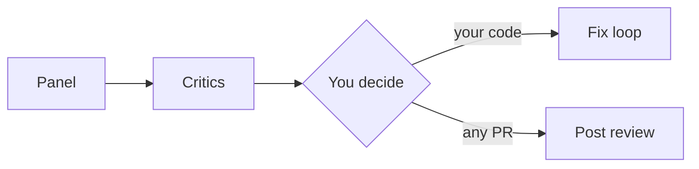

# cc-review runs a panel, then makes it argue

- **Focused reviewers** plus external tools, in parallel
- **Two critics** filter before you see anything
- **You decide**: fix your own code, or post to the PR
- **Local first**: before you push

<!--
**Goal:** the one-sentence pitch, and the four ideas behind it.

**Say:**

"cc-review is a plugin for Claude Code, Codex and OpenCode. Its answer to the noise problem: don't trust one reviewer. Run several focused ones, and let critics check their work before anything reaches you."

"Four ideas. First, focused reviewers: each one has a single job, and external tools like CodeRabbit and Codex join as panel members. Second, two critics, a Skeptic and a Calibrator, go over every finding. Third, you decide what happens with the findings. On your own code, cc-review can fix them, run the tests and review again. On a pull request it can post the review. And on someone else's PR it never touches the code; it only offers to post. And fourth, it runs locally, before you push. The noise never ends up in a PR thread where your colleagues have to read it."

**Background:**

- Why a panel: every reviewer has blind spots, and models from the same vendor share them. Reviewers from different vendors miss different things.
- When several reviewers report the same problem, that's a strong signal. cc-review records it on the finding (`also_reported_by`).
- The industry arrived at the same pattern: Cursor Bugbot runs eight parallel passes plus a validator, Anthropic's Code Review uses an agent team with a verification step. cc-review does this locally and mixes vendors.

**If asked:**

- *Does it fix code automatically?* Only when you choose a fix option from the menu after the findings, and only on your own branch or a PR you authored. Non-interactive runs (`ci`) can fix without asking, again only on your own code; `--no-fix` turns that off.

- *Doesn't that cost more than one bot?* Yes. Each prompt reviewer is a subagent with its own tokens. The `quick` profile is the cheap path; there's a backup slide on cost.

**Transition:** "And review is only one of five commands."

*Timing: 90 s*
-->
