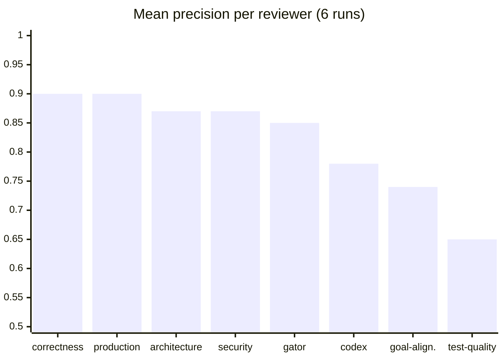

# The panel grades itself on every run

- **test-quality** lowest in every run: tune it first

<!--
**Goal:** reviewer quality is measured, not assumed; the scores tell you what to tune.

**Say:**

"Every report has a quality score per reviewer. The Calibrator estimates how many of each reviewer's findings hold up, and how much is noise."

"This chart is the average over six runs. Correctness and Production Readiness are at the top, around 0.9. Test Quality is at the bottom, 0.65, and it was the lowest in every single run."

"That's actionable. It tells me which lane to tune first: a few lines in the review hints, or switching it off for a project where it doesn't help."

**Background:**

- Small sample: 2 to 6 runs per reviewer. Read it as a trend, not a benchmark.
- Why Test Quality scores low: most of its findings are "this case is not covered", which is true but rarely Important. The Calibrator downgrades them, and that lowers the score.
- Codex at 0.78: external tools don't get the shared preamble, which probably explains why more of their findings are adjusted.

**If asked:**

- *Who grades the Calibrator?* Nobody, yet. The labeled OpenShell data (which findings got fixed, which were rejected) is the start of an evaluation set for exactly that.

**Transition:** "Findings that survive go into the fix loop."

*Timing: 90 s*
-->
