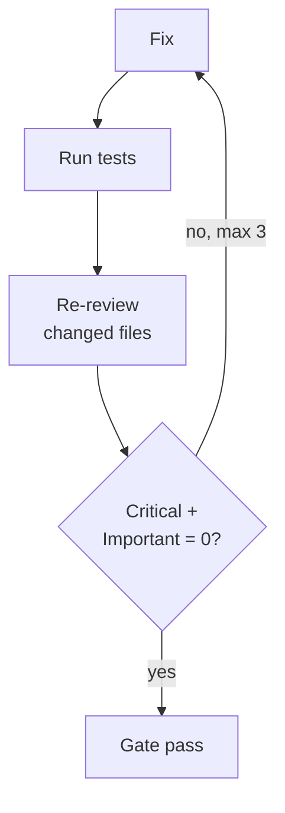

# On your own code: fix, test, re-review

82%

of Critical + Important fixed (547 of 670, 140 reports)

- You pick: all fixes, or gate only
- Failing test → **Critical** finding
- Others' PRs: post, never push

<!--
**Goal:** on your own code, review ends in changed code, and a fix can't silently break things.

**Say:**

"This is where review turns into something that changes the code, as long as it's your code."

"The gate is simple: no Critical and no Important findings left. Minor and Notable never block."

"After the findings, cc-review asks what you want: apply all suggested fixes, only the important ones, post to the PR, or nothing. If you choose to fix, it fixes the findings, runs your test suite, and reviews again, but only the files it just changed. A failing test turns into a new Critical finding, so a fix can't quietly break something else. Up to three rounds by default."

"This only works on your branch or on a PR you wrote. On someone else's PR the fixes would be pushed to their branch, so cc-review only offers to post the review."

"Does it work? In 140 local reports, 82% of the Critical and Important findings were fixed in the loop."

**Background:**

- Fixes are applied bottom-up within a file, so line numbers of the remaining findings stay valid.
- Re-reviewing only the changed files keeps later rounds short.
- The 140 reports go back to March. Most come from cc-review's predecessor, spex deep-review, which used the same loop.
- `--no-fix` turns the loop off; `--max-rounds` changes the limit (`thorough` allows more rounds).

**If asked:**

- *Do you trust automatic fixes?* On your own branch they land in your working tree, uncommitted, and you review the diff. On a PR checkout they're only offered when you're the PR's author: you pick the option, and the fixes are committed in the PR worktree and pushed to the PR branch, never with force. On someone else's PR you can only post.

**Transition:** "Fixing your own branch is one thing. What about other people's PRs?"

*Timing: 90 s*
-->
