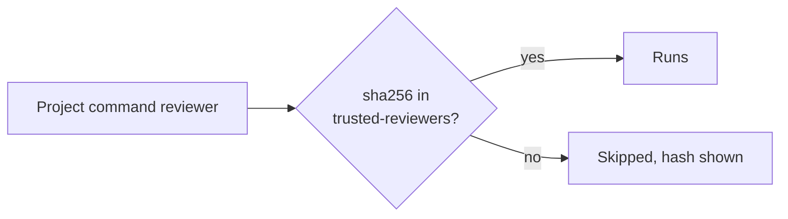

# Project reviewers run only after you trust them

- A change **cannot judge itself**
- Fork checkouts: command reviewers skipped

<!--
**Goal:** the project layer is attacker-controlled input, and cc-review treats it that way.

**Say:**

"The project layer comes from the code under review. That means whoever writes the change also controls it. Two rules handle that."

"First, a change can't judge itself. If a pull request edits or adds a reviewer, that reviewer is ignored for this run, and the bundled or user version of the same name runs instead."

"Second, project reviewers that run commands execute shell commands with your credentials. They don't run until you trust them: you add their name and a SHA-256 hash to a file in your home directory. Change one character, and you need a new hash. `init` prints the line for you."

"And in checkouts of pull requests from forks, command reviewers don't run at all, unless you opt in per reviewer."

**Background:**

- Why forks: a tool like Codex or CodeRabbit could read agent instructions that the fork's author placed in the PR, a prompt injection path.
- Prompt reviewers and user or bundled reviewers need no trust: they don't execute anything from the repository.
- The trust file: `~/.cc-review/trusted-reviewers`, one `<name> <sha256>` per line.

**Transition:** "Let's sum up before we check on our review."

*Timing: 90 s*
-->
