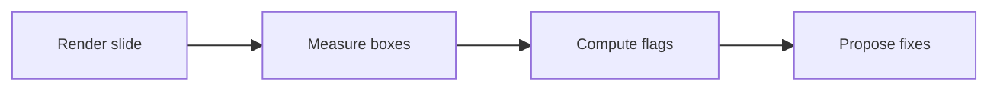

# clean

A balanced control slide: a short lead paragraph and a handful of bullets that fill the middle of the canvas.

- Render every slide of the deck in its last click state, so all content is visible
- Measure the fill ratio over the content area from the rendered text and boxes
- Compare the lowest content edge with the canvas height to catch top-heavy slides
- Check body text and diagram label sizes against the minimums for the room
- Report the flags next to each slide together with the measured values
- Hand the remaining issues back to the presenter after at most three rounds

---

# sparse

- One idea
- Another idea

---

# crowded

| Signal | Threshold | Source | Notes |
|---|---|---|---|
| Fill ratio | 35% to 75% | content boxes | union over a 4px grid |
| Vertical spread | 55% or more | lowest edge | measured on the canvas |
| Body text | 18pt or more | p, li, td, th | headings excluded |
| Diagram labels | 14pt or more | inline SVG | images unmeasured |
| Columns | 75% or more | two-cols | shorter over taller |
| Rounds | at most 3 | per slide | then hand back |

---

# overflow

<div class="w-1/2">

```js
// Runs past the bottom of the canvas.
export function step01() { return 1 }
export function step02() { return 2 }
export function step03() { return 3 }
export function step04() { return 4 }
export function step05() { return 5 }
export function step06() { return 6 }
export function step07() { return 7 }
export function step08() { return 8 }
export function step09() { return 9 }
export function step10() { return 10 }
export function step11() { return 11 }
export function step12() { return 12 }
export function step13() { return 13 }
export function step14() { return 14 }
export function step15() { return 15 }
export function step16() { return 16 }
export function step17() { return 17 }
export function step18() { return 18 }
export function step19() { return 19 }
export function step20() { return 20 }
export function step21() { return 21 }
export function step22() { return 22 }
export function step23() { return 23 }
export function step24() { return 24 }
export function step25() { return 25 }
export function step26() { return 26 }
export function step27() { return 27 }
export function step28() { return 28 }
export function step29() { return 29 }
export function step30() { return 30 }
export function step31() { return 31 }
export function step32() { return 32 }
export function step33() { return 33 }
export function step34() { return 34 }
export function step35() { return 35 }
export function step36() { return 36 }
export function step37() { return 37 }
export function step38() { return 38 }
export function step39() { return 39 }
export function step40() { return 40 }
```

</div>

---
layout: two-cols
---

# lopsided

- One short point

```bash
render-slides.sh ensure --deck .
render-slides.sh server start --deck .
render-slides.sh render --deck . --round 1
render-slides.sh server stop --deck .
/slidev:balance
/slidev:balance 5
```

::right::

- The right column carries a long list that wraps onto a second line
- Each bullet adds another line or two of text to this column
- The left column stays almost empty next to it
- So the shorter column ends far above the taller one
- That height ratio is what the lopsided check measures
- One more bullet makes the gap between the columns even wider

---

# small-text

This slide sets its body text to 14px with a scoped style, which is below the 18pt minimum for body text even though the amount of content is fine.

- Paragraphs and list items both use the smaller size, which squeezes more words into every line of the slide
- Headings are excluded from the body text check, so the title keeps its size and does not trigger the flag
- The fill ratio stays inside the balanced band, because each bullet runs across most of the content width
- The lowest content edge sits well below the middle of the canvas, so the vertical spread is fine as well
- Only the text size is wrong on this slide, and the report names the smallest measured size in points
- A presenter would raise it back to the deck default and then split the slide if the text no longer fits
- The fix is a style change, not a layout change, so the balance pass proposes removing the scoped style
- Nothing else about this slide needs attention, which keeps the small-text flag the only one it carries
- Code blocks and footers are not body text, so a slide with only small code would not carry this flag
- Diagram labels have their own, lower minimum and are checked separately from the body text size

<style>
p, li { font-size: 14px; }
</style>

---

# tiny-labels

The diagram below is rendered inline as SVG, with its labels set to 10px through the Mermaid theme variables.



- Body text keeps the default size of the deck, so only the labels are too small
- Only the diagram labels fall below the minimum label size for the back row
- The diagram itself fits on the canvas and leaves room for the bullets below
- The fix is a larger font size in the init directive at the top of the diagram

---
layout: statement
---

# statement

One idea, centered on purpose.

---
balance: sparse-ok
---

# opt-out

Intentionally sparse.

---

# reveal

<v-clicks>

- The first bullet appears on the first click and carries a long sentence, so that it wraps onto a second line of text
- The second bullet appears on the next click and adds two more lines, which pushes the content further down the slide
- The third bullet follows and keeps the slide growing toward the lower half, still wrapping onto a second line
- The fourth bullet adds another two lines of text, so that the list now reaches past the middle of the canvas
- The fifth bullet completes the slide, which is balanced only in this last click state

</v-clicks>

---
hide: true
---

# hidden

This slide is hidden and never rendered.
