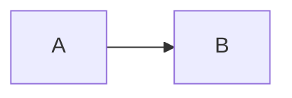

# Architecture overview

## Subheading words are ignored

Intro sentence with five words.

1. First numbered step
2) Second numbered step
* Star bullet
+ Plus bullet




```ts
const notCounted = 'these words are code';
```

<Excalidraw drawFilePath="./diagrams/arch.excalidraw" />

<ul>
  <li>Html item</li>
</ul>

<!-- notes: ignored words here -->
